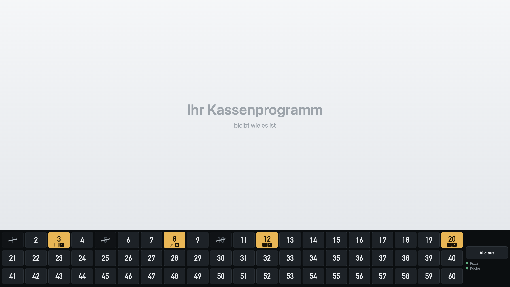
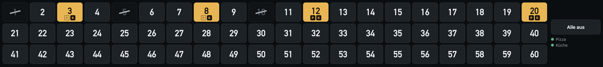
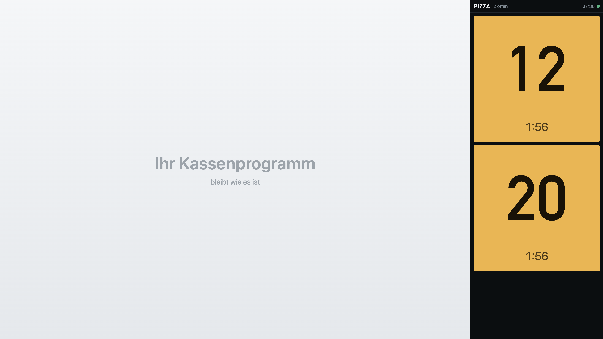
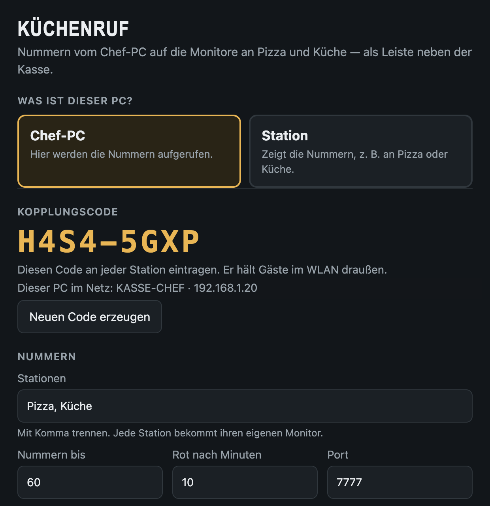
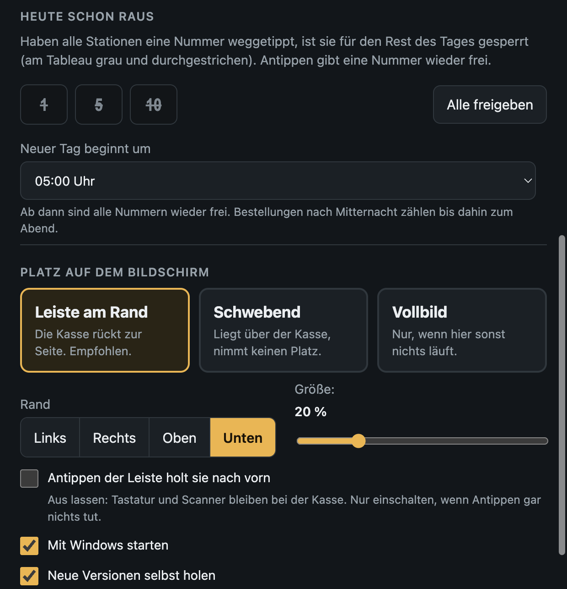

# Küchenruf

**Abholnummern vom Chef-PC direkt auf die Monitore in der Küche — statt rufen.**

Der Chef tippt eine Nummer an, sie erscheint groß an Pizza, Küche oder jeder anderen Station. Wer sie
gesehen hat, tippt sie weg. Am Chef-PC sieht man jederzeit, welche Station noch offen ist. Ist eine
Bestellung durch, steht ihre Nummer für den Rest des Tages grau und durchgestrichen da.

Küchenruf läuft als schmale Leiste am Bildschirmrand **neben der Kassen-Software** — die Kasse rückt zur
Seite wie bei der Taskleiste, Tastatur und Scanner bleiben bei ihr.

- **Kostenlos**, ohne Konto, ohne Cloud: läuft nur im Hausnetz
- Ein Programm für alle PCs (Windows 10 / 11, Touch-Monitor empfohlen)
- Gäste im WLAN sehen nichts: Kopplungscode zwischen Chef-PC und Stationen
- Aktualisiert sich selbst; die Einstellungen bleiben dabei erhalten

## So sieht es aus

**Am Chef-PC** liegt die Leiste unter der Kasse. Gelb = gerufen, darunter je Station ein Kürzel:
ausgefüllt = dort noch offen, hohl = dort schon weggetippt. Grau und durchgestrichen = heute schon raus.
Rechts sieht man, ob die Monitore an Pizza und Küche verbunden sind.

**An der Station** (hier Pizza) erscheinen die Nummern groß neben der Kasse, mit der Zeit seit dem Aufruf.
Antippen = gesehen. Wartet eine Nummer zu lange, wird sie rot.

**Einrichten** geht in einem Fenster: Chef-PC oder Station, Kopplungscode, Stationen, Platz auf dem
Bildschirm. Hier lassen sich auch Nummern wieder freigeben, die heute schon raus sind.

## Herunterladen

👉 **[Neueste Version](https://github.com/walterdill80/kuechenruf-download/releases/latest)** —
dort `Kuechenruf-<version>-Windows.zip` herunterladen.

## Einrichten in drei Schritten

1. Zip auf jedem PC entpacken, z. B. nach `C:\Kuechenruf`, und `Kuechenruf.exe` starten.
   Meldet Windows „Der Computer wurde durch Windows geschützt“: **Weitere Informationen → Trotzdem ausführen**.
2. **Chef-PC** zuerst: „Chef-PC“ wählen, Stationen eintragen (z. B. „Pizza, Küche“), speichern.
   Fragt Windows nach der Firewall: **Zugriff zulassen**. Den Kopplungscode notieren.
3. **Stationen**: „Station“ wählen → „Im Netz suchen“ → Chef-PC antippen → Kopplungscode eintragen →
   eigene Station wählen → speichern.

Küchenruf startet danach mit Windows von selbst. Einstellungen: Küchenruf-Symbol unten rechts neben der Uhr.

## Nutzungsbedingungen und Haftung

Küchenruf ist kostenlos und darf unverändert und kostenlos weitergegeben werden. Es wird ohne Gewähr
überlassen: Der Anbieter haftet nur für Vorsatz und grobe Fahrlässigkeit (die gesetzliche Haftung für
Leben, Körper, Gesundheit und nach dem Produkthaftungsgesetz bleibt). Küchenruf sammelt keine Daten;
für Download und Updates ruft es Dateien bei GitHub ab. Alles Weitere:
**[Nutzungsbedingungen](NUTZUNGSBEDINGUNGEN.md)**.

## Von

Küchenruf ist ein Programm von **[JumpX OS](https://jumpx-os.de)**.

JumpX · Walter Dill · Schönebeck 16 · 31241 Ilsede  
Telefon +49 176 43437275 · kontakt@jumpx.de · [jumpx-os.de](https://jumpx-os.de)

Fragen, Wünsche, Fehler: einfach anrufen oder schreiben.
